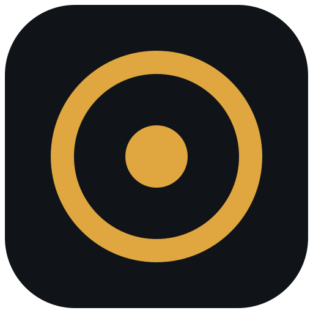
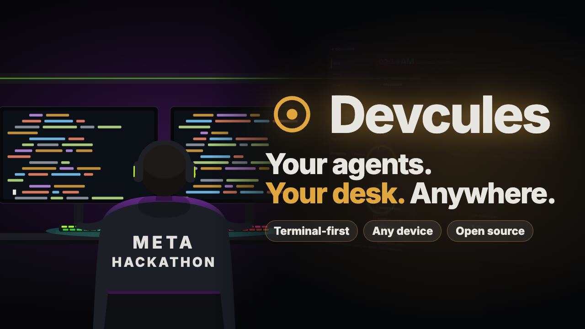
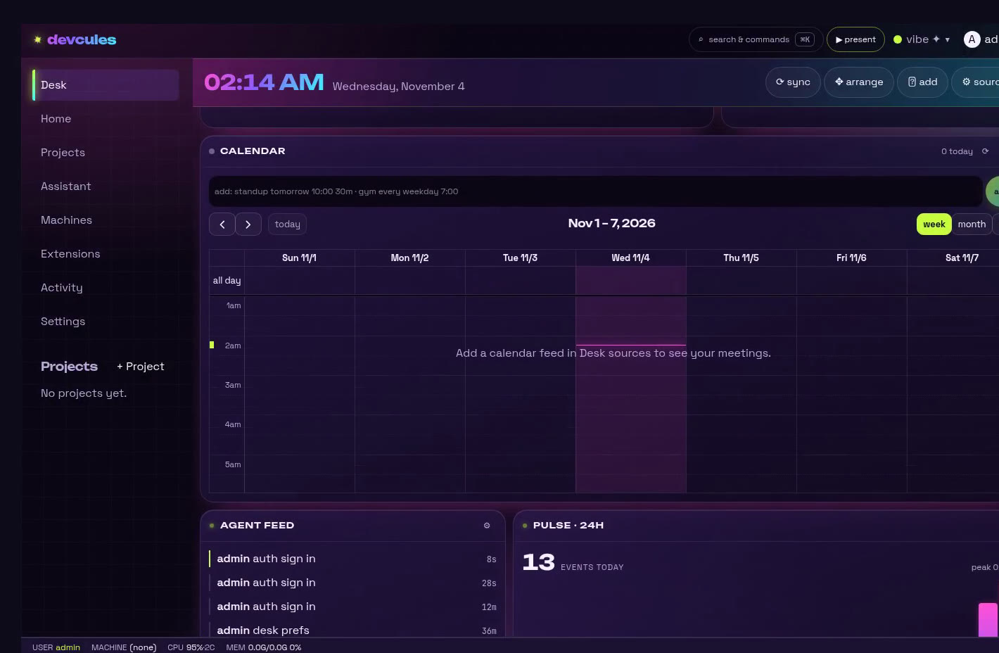
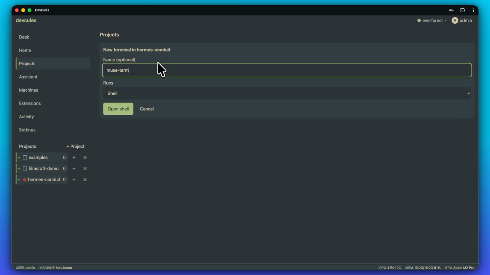
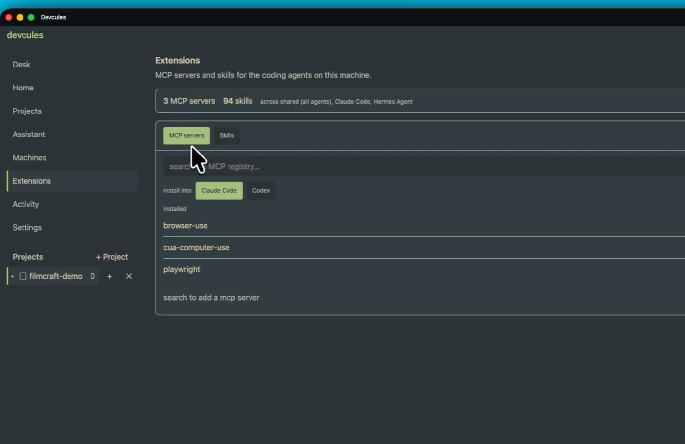
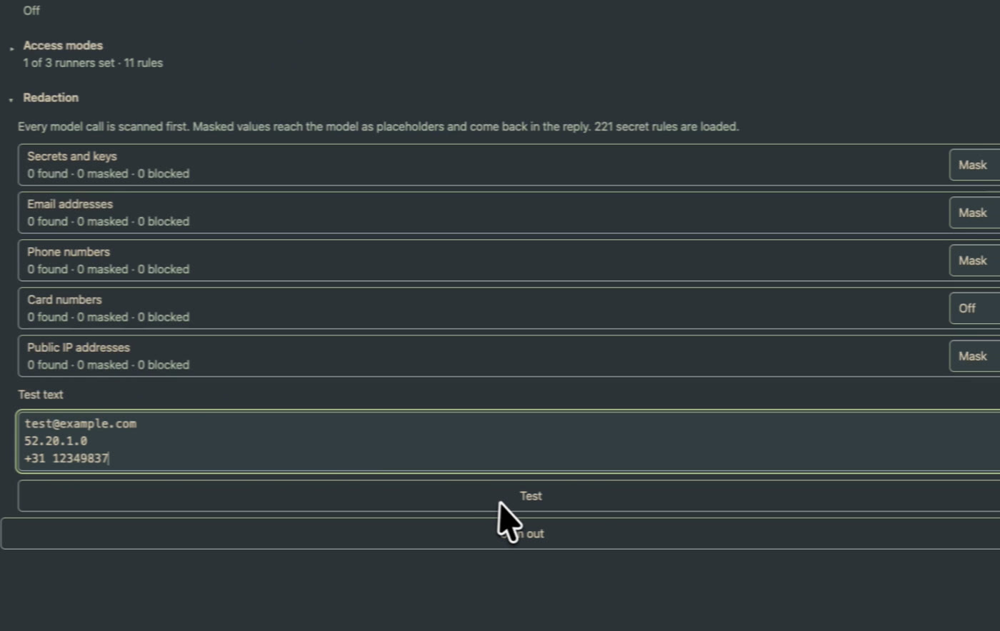
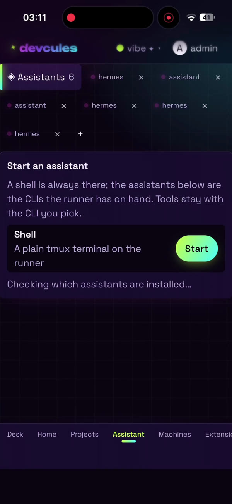
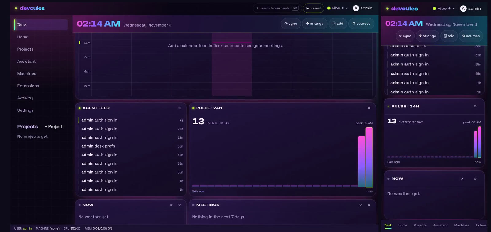
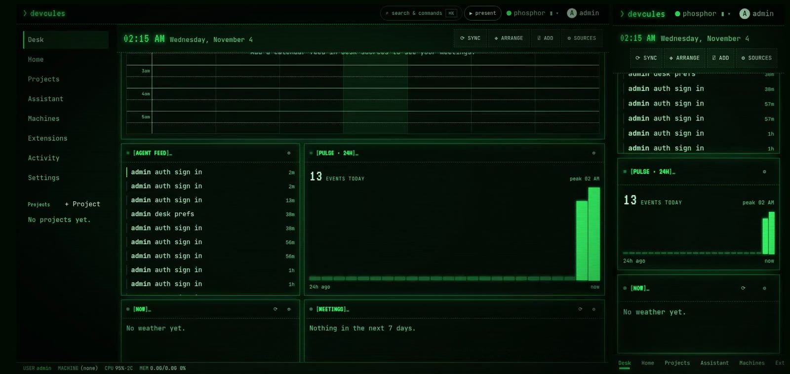
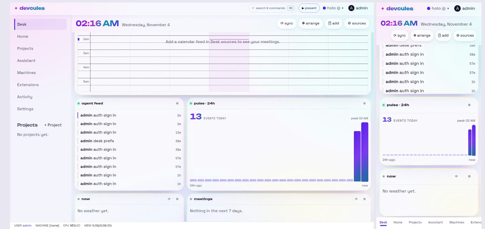

<div align="center">



# Devcules

**Your favorite agent harness, personalized by you.**

An open-source, terminal-first dev desk for AI coding agents.
Run Muse Code, Claude Code, Codex or Hermes on your own machines,
and reach your desk from your laptop, phone or iPad over your tailnet.

[](https://github.com/devcules/devcules/actions/workflows/ci.yml)
[](LICENSE)
[](go.mod)
[](https://devcules.github.io/devcules/)

[**Watch the demo**](https://youtu.be/XtRAsomVlAs) ·
[**Website**](https://devcules.github.io/devcules/) ·
[**Quick start**](#quick-start) ·
[**Docs**](#docs)

<br>

<a href="https://youtu.be/XtRAsomVlAs" title="Watch the Devcules demo on YouTube">
  
</a>

<sub>▶ Click to watch the 3 minute demo on YouTube</sub>

</div>

---

## Every developer is unique

We each have a favorite coding agent, ticket board, calendar and news
feed, so one-size-fits-all tools never quite fit. And the day is spent
hopping between windows, terminals and devices to keep up with the
agents doing the work.

Devcules, named after Hercules, is a strong skeleton you tune to fit
you:

- **A personal harness, unique to each dev.** Your agents, your
  providers, your panels, your theme. Your own agent can even reshape
  Devcules itself.
- **Any device, including a real terminal on your phone.** The same
  desk and the same live tmux sessions follow you from laptop to phone
  to iPad.
- **A dev sandbox per terminal.** Every terminal opens in a project on
  the machine you pick: this computer, a second box, or a container.
- **Less context and screen switching.** Calendar, tickets, approvals,
  agent feed and terminals sit on one desk, and the risky steps come
  to you.

## What you get

<table>
<tr>
<td width="50%" valign="top">

### A desk you shape

Calendar, meetings, tickets (Jira, Asana or Linear), news searches, a
focus timer, quick links and a scratchpad. Add, move, resize or remove
any panel, and pick each panel's source.

</td>
<td width="50%"></td>
</tr>
<tr>
<td width="50%"></td>
<td width="50%" valign="top">

### Any machine, any harness

Add a computer with one line and it enrols over your tailnet. Open a
project on any machine and start a terminal with Muse Code, Claude
Code, Codex, or an assistant like Hermes. tmux is the source of truth,
so a session survives a closed tab.

</td>
</tr>
<tr>
<td width="50%" valign="top">

### MCP registry built in

Browse the MCP servers and skills your agents share, then search the
registry and install into Claude Code or Codex, from the browser.

</td>
<td width="50%"></td>
</tr>
<tr>
<td width="50%"></td>
<td width="50%" valign="top">

### Secure by default

Passkey sign-in, access only over your own tailnet (no public ports),
and write-only secrets in the vault. Redaction masks keys, emails,
phone numbers and IP addresses before any model call leaves the
machine, and risky agent steps wait for your approval.

</td>
</tr>
<tr>
<td width="50%" valign="top">

### Anywhere, on any device

The desk is a PWA that works on a phone, a tablet or a laptop. Approve
a step with Face ID, or drop into your remote terminal from the couch.

</td>
<td width="50%" align="center"></td>
</tr>
</table>

### Every personality has a theme

Pick one, or ask the assistant to make one for you.

<p align="center">
  
  
  
</p>

## Quick start

One command on your computer:

```sh
go install github.com/devcules/devcules/cmd/devcules@latest
devcules
```

That runs serve and its own host runner in one process, on
http://127.0.0.1:7659. It sets no environment variable and asks nothing:
the Projects picker sees your own folders, named **host (this
computer)**, and the first start prints a bootstrap admin password.

**In the first two minutes** you have: the web desk on the loopback,
a **Projects** tree of the machine's folders, a **Terminals** tab to
run an agent in one, and an **Assistant** tab that chats with the
setup helper (it asks before it changes anything; your phone answers).
The three-line walkthrough:

1. Open http://127.0.0.1:7659 and sign in (the bootstrap password the
   first start printed; you add a passkey once, and the phone's
   Touch ID / Face ID is the sign-in after).
2. In **Providers** save your Meta key; set `META_API_KEY` once and it
   is in the vault forever (you can unset the variable).
3. Ask the Assistant "which providers do I have and which runner is
   live". It reads the live setup through the same MCP tools agents
   use, and any change it proposes waits for your approval first.

### Run it in a container

Prefer the sandbox over the host? The full stack (serve, a runner
rooted at your `~/code`, the vault all in one volume) is one compose
up:

```sh
docker compose -f deploy/compose.yaml up -d --wait
```

### Reach it from your phone

The phone reaches the desk over your tailnet, never a public port:

```sh
echo "TS_AUTHKEY=tskey-auth-…" > .env
docker compose -f deploy/compose.yaml --profile tailscale up -d --wait
# the desk is https://devcules.<your-tailnet>.ts.net
```

### Add more machines

A sandbox or a second machine is a machine you add from the GUI:
**Machines → Add a computer**. The compose stack is the container
option, and it shows up as **container (…)** so the desk never
confuses it for your own filesystem. See [docs/deploy.md](docs/deploy.md)
for environment, hardening and limits.

## Docs

| Topic | |
|---|---|
| Architecture | [docs/architecture.md](docs/architecture.md) |
| Deploy, hardening and limits | [docs/deploy.md](docs/deploy.md) |
| Machines and runners | [docs/machines.md](docs/machines.md) |
| Terminals | [docs/terminals.md](docs/terminals.md) |
| Agents and assistants | [docs/agents.md](docs/agents.md), [docs/assistants.md](docs/assistants.md) |
| Model providers | [docs/providers.md](docs/providers.md) |
| MCP and extensions | [docs/mcp.md](docs/mcp.md) |
| Approvals | [docs/approvals.md](docs/approvals.md) |
| Security, auth, vault and redaction | [docs/security.md](docs/security.md), [docs/auth.md](docs/auth.md), [docs/vault.md](docs/vault.md), [docs/redact.md](docs/redact.md) |
| The full plan | [PLAN.md](PLAN.md) |

## Contributing

Issues, ideas and pull requests are all welcome. Devcules is built one
module per pull request, each with tests, `go vet` and a dated
`CHANGELOG.md` entry. See [CONTRIBUTING.md](CONTRIBUTING.md) and the
CI setup in [docs/ci.md](docs/ci.md).

If Devcules fits the way you work, a ⭐ helps others find it.

## Licence

Apache-2.0. See [LICENSE](LICENSE), [NOTICE](NOTICE) and
[THIRD_PARTY_NOTICES.md](THIRD_PARTY_NOTICES.md).

---

<div align="center">
<sub>Built for the Meta Hackathon. Thank you to Meta for the hackathon and Cerebral Valley for hosting.<br>
Built with Muse Code; planning and review with other AI tools.</sub>
</div>
